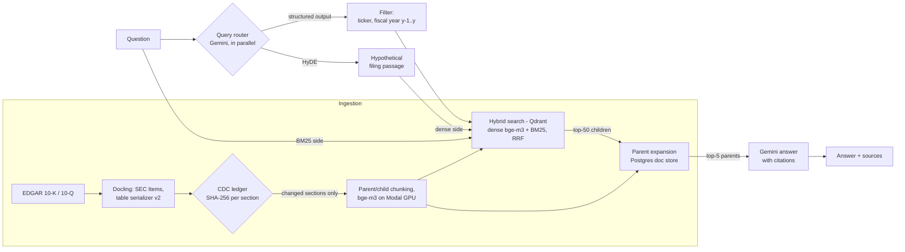

# SEC Financial RAG

Question answering over SEC 10-K and 10-Q filings, with cited sources, built as a series of measured experiments. Every design choice in the pipeline was kept or rejected based on a paired comparison against the previous stage on the same evaluation set, judged against a measured noise floor.

- **Corpus:** 209 filings (10-K, 10-Q) of 30 companies from SEC EDGAR, parsed with Docling into SEC Item sections and tables.
- **Pipeline:** query router (company/year filter + HyDE) → hybrid dense + BM25 search in Qdrant → parent-document expansion from Postgres → Gemini answer with `[n]` citations.
- **Evaluation:** 76 FinanceBench questions; retrieval (Hit@k, MRR), numeric exact match, numeric faithfulness, refusals, cost, latency; paired sign tests.
- **Serving:** FastAPI service with `/query`, `/ingest/delta` (change-data-capture re-indexing), `/metrics`, `/health`.

## Results

| Exp | Change (each row adds to the one before) | Hit@5 | MRR@10 | EM lenient / strict | Refusals | Cost / 1k q |
| :--- | :--- | ---: | ---: | ---: | ---: | ---: |
| Exp-1 | Baseline: naive HTML text, fixed 512-token chunks, dense top-5 | 0.24 | 0.14 | 0.20 / 0.20 | 0.66 | $5.63 |
| Exp-2 | Docling layout parsing, compact tables, contextual headers, section chunks | 0.32 | 0.24 | 0.29 / 0.27 | 0.53 | $4.10 |
| Exp-3 | Parent-document retrieval: ~240-token children matched, ~1,600-token parents sent | 0.42 | 0.29 | 0.45 / 0.39 | 0.32 | $10.90 |
| Exp-3b | Table serializer v2 (85% of table facts kept, from 68%) | 0.46 | 0.31 | 0.45 / 0.39 | 0.33 | $11.11 |
| Exp-4 | Hybrid dense + BM25 with Reciprocal Rank Fusion | 0.49 | 0.34 | 0.39 / 0.37 (repeat 0.43 / 0.39) | 0.33 | $10.22 |
| Exp-4r | + cross-encoder reranker (not adopted) | 0.42 | 0.26 | 0.39 / 0.33 | 0.36 | $10.54 |
| Exp-5a | + query router: company/year pre-filter (Gemini structured output) | 0.55 | 0.37 | **0.51 / 0.45** | 0.28 | $10.80 |
| **Exp-5b** | + HyDE for the dense search (**served by the API**) | **0.63** | **0.42** | 0.49 / 0.43 | **0.22** | $11.77 |
| Exp-F | Framework baseline: LlamaIndex standard components, same prompt/model/metrics | 0.21 | 0.14 | 0.20 / 0.18 | 0.62 | $4.27 |

n = 76 questions (EM on the 51 with a numeric answer); generator `gemini-3.8-flash` at temperature 0; embeddings `BAAI/bge-m3`. Hit@5 and MRR from Exp-3 on are at parent level. Full per-experiment notes, including faithfulness and latency: [`Phase_1_Tech_Spec.md` §5.2–5.3](Phase_1_Tech_Spec.md).

### What the experiments showed

1. **Measure the noise floor first.** Running Exp-4 twice unchanged gave identical retrieval for 76/76 questions (exact search), yet EM flipped on 4 questions and P95 latency moved by 10 s: Gemini is not deterministic at temperature 0. Every later comparison is judged against that floor with paired sign tests.
2. **The answers improved most from what the generator sees.** Parent-document retrieval (Exp-3) was the first clearly significant gain (EM +9 / −1, p = 0.021), and pre-filtering to the right filing (Exp-5a) the next (EM +6 / −0 vs one baseline run, +5 / −1 vs the other): numeric EM was 56% when all five passages came from the gold filing and 30% when filings were mixed.
3. **Better ranking is not always better answers.** Hybrid search (Exp-4) and HyDE (Exp-5b, Hit@5 +6 / −0, p = 0.031) improved retrieval without a measurable EM change. Inspecting the answers showed the numeric-EM metric under-credits yes/no answers with derived figures, so HyDE's answer effect is probably understated (documented, not fixed: [ADR-004](docs/adr/004-query-router-prefilter-hyde-decomposition.md)).
4. **A reranker can lower Hit@k and still not hurt answers.** `bge-reranker-v2-m3` kept the right filing on top as often but preferred other pages of it over FinanceBench's single evidence page, for +3.3 s retrieval latency. Not adopted ([ADR-003](docs/adr/003-hybrid-rrf-and-cross-encoder-latency.md)).
5. **Framework defaults need measuring.** The same task built from LlamaIndex's standard components in ~120 lines (vs ~1,300) scored at the naive-baseline level. An ablation traced it to defaults: relative-score fusion made hybrid worse than dense alone, BM25 without number normalization, auto-merging that merged 1 of 380 slots (so the generator got small leaves), and document-level change detection (one edited sentence re-embedded 100% of a filing vs 5% here). See [Exp-F](docs/experiments/exp-F-framework-baseline.md).
6. **Check the metric before trusting a drop.** Twice a large drop was partly the metric: a faithfulness regex missing bold results (fixed as metric v2), and a relevance judge that could not see the evidence in the framework's chunks for 12 of 76 questions (the gap held on the other 64).

## Architecture



| Stage | Choice | Why (evidence) |
| :--- | :--- | :--- |
| Parsing | Docling HTML → SEC Item sections; own compact table serializer | Docling over Unstructured (table facts kept 94.7% vs 18.9%); own serializer keeps 85% at ~1/4.5 of Docling's native tokens ([ADR-001](docs/adr/001-docling-vs-unstructured-table-parsing.md)) |
| Chunking | Parents ~1,600 tokens, children ~240 tokens, contextual header `[COMPANY \| FILING \| PERIOD \| ITEM]` | Children match precisely, parents give the generator context ([ADR-002](docs/adr/002-parent-document-vs-semantic-chunking.md)) |
| Change detection | Postgres ledger, SHA-256 per section; content-addressed point ids | A one-sentence edit re-embeds one section (5% of a 10-K) |
| Retrieval | Qdrant named vectors (dense + BM25 with IDF), RRF k = 60, numbers kept as one BM25 token | Better ranking (Hit@3 0.37 → 0.43) and exact-wording questions recovered ([ADR-003](docs/adr/003-hybrid-rrf-and-cross-encoder-latency.md)) |
| Routing | Gemini structured output (ticker enum), hard ticker filter, soft year filter; HyDE for the dense side; optional sub-query decomposition | Filter kept the gold filing 76/76; context from the right filing 50/76 (from 30) ([ADR-004](docs/adr/004-query-router-prefilter-hyde-decomposition.md)) |
| Embedding | `bge-m3` fp16; Modal L4 GPU for indexing | Full index 57 min on Modal vs 261 min on a laptop; vectors equivalent (min cosine 0.9995) |

## API

```bash
uv run --env-file .env uvicorn sec_financial_rag.api.main:app --port 8000
# interactive docs: http://localhost:8000/docs
```

| Method | Path | What it does |
| :--- | :--- | :--- |
| `POST` | `/query` | Answer a question: `{"question": "...", "top_n": 5, "hyde": true, "decompose": false}`. Returns `504` if the pipeline takes over 120 s |
| `POST` | `/ingest/delta` | Start a CDC re-index job (`{"tickers": ["MMM"], "use_modal": false}`): only changed sections are re-embedded, then the hybrid collection is synced. Returns `202` and a job id; one job at a time (`409` otherwise) |
| `GET` | `/ingest/delta/{job_id}` | Job status and result (`points_copied`, `points_deleted`) |
| `GET` | `/metrics` | Service counters (queries, errors, refusal rate, latency p50/p95, total cost) and every experiment's headline metrics |
| `GET` | `/health` | Qdrant and Postgres reachability (`503` if either fails) |

```bash
curl -s localhost:8000/query -H 'content-type: application/json' \
  -d '{"question": "What was 3M'\''s total net sales in FY2022?"}'
```

```json
{
  "answer": "3M's total net sales in FY2022 was $34,229 million [1][3].",
  "refused": false,
  "sources": [
    {"n": 1, "ticker": "MMM", "form_type": "10-K", "report_date": "2022-12-31",
     "section_title": "Management's Discussion and Analysis of Financial Condition and Results of Operations.",
     "accession_number": "0000066740-23-000014", "text": "..."}
  ],
  "route": {"ticker": "MMM", "fiscal_year": 2022, "filtered": true, "hyde": true, "decomposed": false},
  "timings_ms": {"route": 5329.8, "retrieval": 1189.2, "generation": 2478.6, "total": 8997.7},
  "cost_usd": 0.010306
}
```

With `"decompose": true`, a comparative question ("Compare 3M and Johnson & Johnson total revenue in FY2022") is split into one filtered search per company, run in parallel, with parents interleaved so both companies reach the generator.

## Quickstart

Requirements: Python 3.12, [uv](https://docs.astral.sh/uv/), Docker, a Gemini API key, optionally a [Modal](https://modal.com) account for GPU indexing.

```bash
cp .env.example .env               # fill in the values (never commit .env)
uv sync                            # locked dependencies
docker compose up -d               # Qdrant, Postgres (CDC ledger + parent store), Phoenix

# 1. Download the filings into data/raw_filings and record them in the ledger
uv run --env-file .env python -m sec_financial_rag.ingestion.edgar_downloader
# 2. Build the evaluation set (FinanceBench slice; generated locally, not committed)
uv run --env-file .env python -m sec_financial_rag.evals.dataset
# 3. Parse, chunk and embed (children -> Qdrant, parents -> Postgres); --modal for the GPU
uv run --env-file .env python -m sec_financial_rag.ingestion.indexer_exp3 \
    --collection exp3b_parent_child_tablesv2_bge_m3 --modal
# 4. Derive the served hybrid collection (dense + BM25, payload indexes)
uv run --env-file .env python -m sec_financial_rag.ingestion.build_exp4
# 5. Serve
uv run --env-file .env uvicorn sec_financial_rag.api.main:app --port 8000
```

Reproduce an experiment row (writes `evals/reports/*_summary.json`):

```bash
uv run --env-file .env python -m sec_financial_rag.evals.runner \
    --collection exp4_hybrid_bge_m3 --mode hybrid --exact --parents --route --hyde
```

`--retrieval-only` skips generation (no Gemini cost); runs checkpoint and resume after failures. The router's extractions and HyDE passages are cached (`scripts/router_accuracy.py`, `scripts/hyde_passages.py`) so repeat runs differ only in retrieval and generation. The LlamaIndex arm lives in its own dependency group: `uv sync --group exp-f`.

Tests: `uv run pytest` (unit tests use fakes and in-memory Qdrant; tests that need running services skip without them). CI runs lint and tests on every push.

## Repository layout

```
src/sec_financial_rag/
├── ingestion/    edgar_downloader, cdc_ledger (SHA-256 ledger), layout_parser (Docling + SEC Items + tables),
│                 fiscal_normalizer, indexer_exp3 (CDC indexing), build_exp4 (hybrid collection + sync),
│                 modal_embedder (bge-m3 / reranker on a Modal GPU)
├── chunking/     fixed_token (Exp-1), semantic_table (Exp-2), parent_child (Exp-3), header injection
├── retrieval/    hybrid (dense + BM25 + RRF), bm25, doc_store (parents), query_router (filter, HyDE,
│                 decomposition), rerank
├── generation/   prompts (citation-enforcing), synthesizer (Gemini)
├── evals/        runner (all experiments), metrics, numeric EM, faithfulness, dataset, judge (built, not adopted)
├── exp_f/        LlamaIndex framework baseline
└── api/          service (query pipeline), main (FastAPI app)
docs/adr/         ADR-001 … ADR-004: decisions with their evidence
docs/experiments/ Exp-F write-up
scripts/          benchmarks and one-off measurements (table fidelity, router accuracy, Exp-F)
tests/            unit and in-memory integration tests
```

## Limitations

- **Small evaluation set.** 76 single-filing questions: differences of a few questions are within run-to-run noise, and sub-query decomposition (built, tested) cannot be measured on it.
- **Answer metric.** Numeric exact match under-credits yes/no answers with derived figures and cannot score non-numeric questions; an LLM judge was built but not validated or adopted.
- **Corpus.** 17 of 30 companies have a single filing, which flatters the company filter; with full filing histories its gain would likely be smaller.
- **Latency.** The router adds two LLM calls before search (run concurrently, ~4–5 s); P95 end-to-end latency is ~23–25 s in the evaluations.
- **Serving.** One process, in-memory metrics, local embedding model; `/ingest/delta` loads a second model copy, so on small machines run it with `use_modal: true`. One intermittent hang of a decomposed query was seen under memory pressure and not reproduced; queries now time out with `504` instead.

## Data and licensing

Code: [MIT](LICENSE). Filings are public SEC EDGAR documents. FinanceBench questions and answers are not redistributed: the evaluation set and per-question reports are generated locally and git-ignored; only aggregate metrics are committed.
